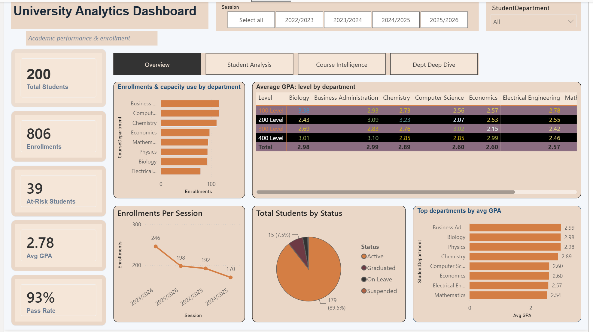
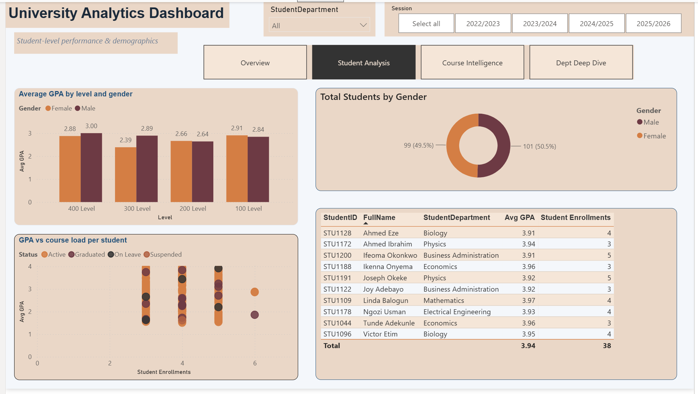
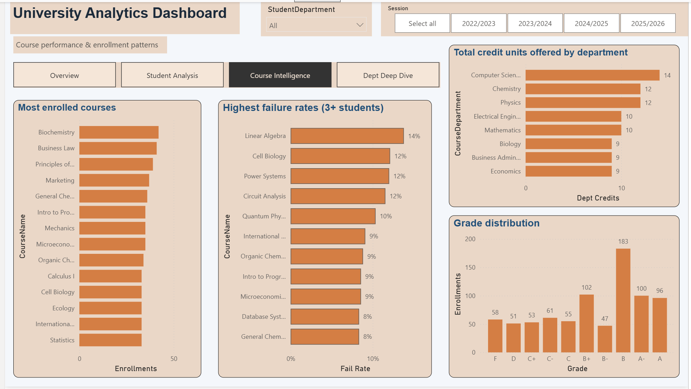
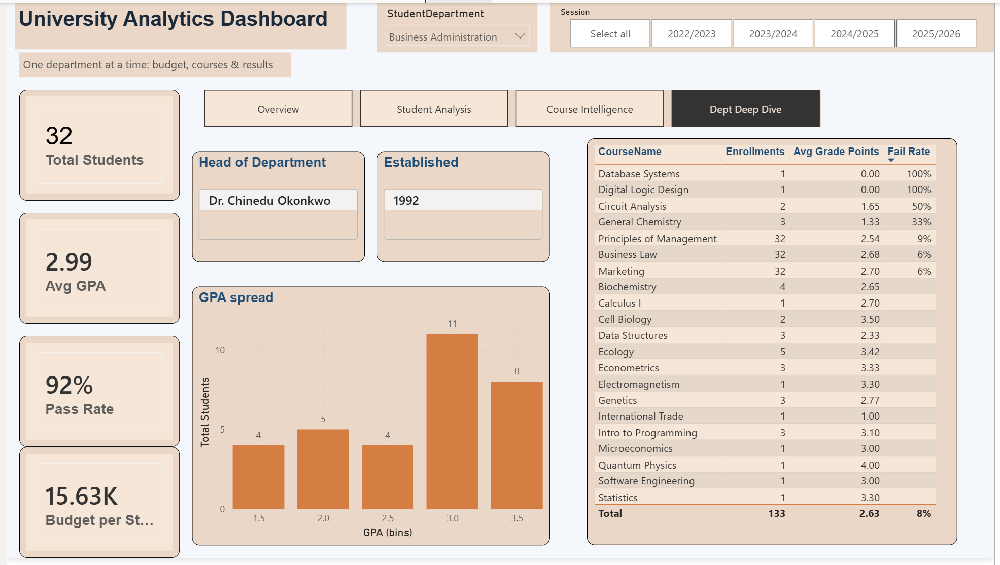

# 🎓 University Analytics Dashboard

A 4-page Power BI report built on a self-generated, self-flattened university dataset — covering student performance, course outcomes, and department-level budgeting.

**Tools:** Power BI Desktop · Excel · DAX
**Author:** Maryam Alabi ([GitHub](https://github.com/OyinTechLab))

---

## 📌 Project Overview

This project simulates a real university's student records system and turns it into an interactive analytics dashboard. The goal was to practice the full analyst workflow end to end:

1. Design a relational dataset (5 linked tables)
2. Flatten it into a single clean table, ready for BI tools
3. Build DAX measures that handle row-level duplication correctly
4. Design a 4-page, cross-filtered, navigable Power BI report in a consistent theme

The dataset is synthetic (not real student data), built specifically for practice — but it's structured the way a real student information system would be, which is what makes the data-modeling and DAX work transferable.

---

## 🗂️ Data Model

The source data started as 5 related Excel sheets:

| Table | Rows | Description |
|---|---|---|
| Students | 200 | Bio-data, department, level, status, GPA |
| Courses | 25 | Course code, title, department, credits, instructor |
| Departments | 8 | Head of department, annual budget, established year |
| Enrollments | 806 | One row per student-course-session, with grade & pass/fail |
| GradeScale | 10 | Letter grade → grade points → remark lookup |

**Step 1 — Flattening:** Rather than loading 5 separate tables into Power BI, I merged them into one flat table (`tblUniversity`, 28 columns) first, joining the tables on `StudentID`, `CourseID`, department and grade. This made the dataset far easier to read and explore for someone newer to the data, at the cost of intentional duplication (a student's GPA, for example, repeats on every row of their enrollments).

**Step 2 — Why that duplication matters:** A flat table is beginner-friendly, but it breaks naive SUM/AVERAGE logic. Every DAX measure in this project is written to correct for that — see below.

---

## 🧮 Key DAX Measures

The core challenge of this project was writing measures that give correct answers despite the flat, duplicated structure.

```DAX
-- Count each student once, not once per enrollment row
Students = DISTINCTCOUNT(tblUniversity[StudentID])

-- Average each student's GPA once, not once per row they appear in
Avg GPA =
AVERAGEX(
    VALUES(tblUniversity[StudentID]),
    CALCULATE(MAX(tblUniversity[GPA]))
)

-- Sum each course's capacity once, not once per student enrolled in it
Capacity =
SUMX(
    SUMMARIZE(tblUniversity, tblUniversity[CourseID], tblUniversity[MaxCapacity]),
    tblUniversity[MaxCapacity]
)

-- A department's budget repeats on every row — read it once, don't add it up
Dept Budget = CALCULATE(MAX(tblUniversity[DeptAnnualBudget]))

-- How many courses THIS student is taking, ignoring filters from elsewhere on the chart
Student Enrollments =
CALCULATE(
    COUNTROWS(tblUniversity),
    ALLEXCEPT(tblUniversity, tblUniversity[StudentID])
)

Pass Rate = DIVIDE(CALCULATE(COUNTROWS(tblUniversity), tblUniversity[Passed] = "Yes"), COUNTROWS(tblUniversity))
Fail Rate = DIVIDE(CALCULATE(COUNTROWS(tblUniversity), tblUniversity[Passed] = "No"), COUNTROWS(tblUniversity))
```

**The pattern worth remembering:** `DISTINCTCOUNT` / `AVERAGEX(VALUES(...))` for student-level facts, `SUMX(SUMMARIZE(...))` for course/department-level facts, `MAX()` inside `CALCULATE` for values that repeat identically across many rows. This is the single biggest lesson from the project — a flat table needs its measures to re-establish the grain that a normalized model would have given for free.

---

## 📊 Dashboard Pages

### 1. Overview


High-level KPIs (students, enrollments, avg GPA, at-risk count, pass rate), enrollment-vs-capacity by department, a GPA heatmap (level × department), enrollment trend across sessions, and student status breakdown.

**Key insight:** Performance varies sharply by department — Business Administration and Biology average close to 3.0 GPA, while Computer Science and Electrical Engineering trail around 2.5–2.6, despite similar enrollment and capacity levels.

### 2. Student Analysis


GPA by level and gender, a GPA-vs-course-load scatter plot colored by enrollment status, gender split, and a top-10 students table.

**Key insight:** The GPA-vs-course-load scatter flags a student carrying 6 concurrent enrollments with a low GPA and "Suspended" status — a visible example of overload coinciding with academic risk, the kind of pattern a student success team would want surfaced automatically.

### 3. Course Intelligence


Most-enrolled courses, highest fail-rate courses (filtered to 3+ students to avoid small-sample noise), grade distribution, and total credit units offered by department.

**Key insight:** Grade distribution skews positive overall (B is the modal grade), which puts the 12–14% fail rates in Linear Algebra, Cell Biology, Power Systems, and Circuit Analysis into sharper relief as genuine outliers worth department-level attention.

### 4. Dept Deep Dive


A single-select department filter drives a full page of department-specific detail: head of department, year established, KPIs, a course performance table, and a GPA-spread histogram.

**Key insight:** This page is also a cautionary lesson in my own build — two courses showed a 100% fail rate, which turned out to be single-enrollment courses (1 student, 1 fail), not a real trend. I'd apply the same "min 3 enrollments" filter used on Course Intelligence here too, since a results table that doesn't account for sample size can mislead a decision-maker.

---

## 🛠️ Build Notes & Lessons Learned

- **Flat vs. normalized trade-off:** flattening the 5 tables made the dataset approachable, but every "total" or "average" measure needed deliberate DAX to avoid double-counting. In a real analyst role I'd weigh this against keeping the star-schema model and relying on relationships instead.
- **Small-sample distortion:** raw fail-rate/pass-rate numbers can be misleading when a course only has 1–2 enrollments. Filtering to a minimum enrollment count before ranking is now a pattern I apply by default.
- **Navigation UX:** Power BI's Page Navigator button only activates in Reading View or with Ctrl+Click while editing — worth knowing so you're not debugging a "broken" button that was never broken.
- **Consistent theming across 4 pages** (fonts, card borders, color rules) made the report feel like one coherent product rather than four separate charts pasted together.

---

## 📁 Repo Contents

```
├── README.md
├── University_Dataset_Flat.xlsx      # the flattened source table
├── University_Dashboard.pbix         # the Power BI report
└── screenshots/
    ├── overview.png
    ├── student_analysis.png
    ├── course_intelligence.png
    └── dept_deep_dive.png
```

---

## 📬 Contact

**Alabi Maryam Oyinkansola**
Data Analyst | Excel · SQL · Power BI
📧 oyintechlab@gmail.com · 🔗 [github.com/OyinTechLab](https://github.com/OyinTechLab)
